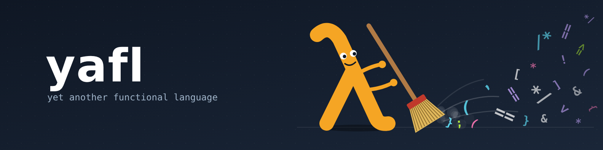

<p align="center">
  
</p>

# YAFL: Yet Another Functional Language

[](https://github.com/supersoftcafe/yafl/actions/workflows/full-gate.yml)
[](LICENSE)

**A statically typed functional language that compiles to C. Read-only by default,
async and parallel without the keywords, with its own concurrent garbage collector.
The compiler is written in YAFL and compiles itself.**

**Status:** working and self-hosting, under heavy development. The language, the
standard library and the runtime are all still changing, and there is no 1.0 yet.

## A taste

```yafl
namespace Test

import System

fun createMessage(name: String): String
  ret $"Hi {name}, how're you\n"

let message: String = createMessage("Jeff")

fun main(): Int
  print(message)
  ret 0
```

Indentation is the block structure: no braces, no semicolons. Failure is a union type
that you `match` on, not an exception:

```yafl
match(divide(10, 2))
  (_:None)      => print("division by zero\n")
  (result: Int) => print(result)
```

Generics are constrained by traits, in the spirit of Rust:

```yafl
interface Stringable<T>
  fun toString(t: T): String

fun printValue<T>(value: T): None where Stringable<T>
    System::print(toString(value))
    ret None
```

Real programs live in [`examples/`](examples/): a ray tracer, a Lisp interpreter, a JSON
pretty-printer, a spell checker and more. Stream pipelines read like this
(from [`linenumbers.yafl`](examples/linenumbers.yafl)):

```yafl
let out = writeStream(stdout(), once(text) |> toLines |> prependLineNumbers)
```

## Why YAFL?

I have read a lot of books and papers on compilers, register allocators and
optimisation, and worked in many languages (C, C++, Python, Kotlin, C#, Java,
Modula-2, Miranda, BBC Basic and assorted assembly). YAFL is my attempt to build the
language I think those experiences add up to.

The bet is this: **you should write plain, side-effect-free code, and the compiler
and runtime should decide what runs in parallel and what suspends.** No `async` and
`await`, no threads, no locks in ordinary code.

- **Read-only by default.** Mutability should be hard to ask for. That is better for
  correctness, and it is also what lets the compiler and the GC be clever.
- **Implicit async.** Every function is async under the covers unless the compiler
  can prove it never suspends. The programmer never sees this. (Think of how C#'s
  `async` spreads through a codebase until you wonder why the keyword exists.)
- **Implicit parallelism.** Evaluation order is not guaranteed, so independent `let`s
  and call arguments can be turned into parallel work, guided by a cost estimator.
- **Linear types for IO.** Files and handles are closed by the type system, with no
  finalizers and no `IDisposable`.
- **Unbounded integers.** `Int` never overflows, like Python. Small values are packed
  into the pointer, so they cost no allocation.
- **Ambiguity is an error.** If the compiler can't tell what you mean, it says so.
- **Familiar OO as well.** Classes, interfaces, inheritance and overloading.

## How it works

```
 .yafl source  →  yaflc  →  C  →  your C compiler  →  native binary
                  (YAFL)         + YAFL runtime (C)
```

- **Compiles to C.** The compiler only needs to know the word size of the target
  architecture. I started on LLVM IR and moved to C for portability and library
  integration.
- **Whole-program build.** One application, one binary, statically linked.
- **Thread per core.** Worker threads do CPU work only, and all IO is async.
- **Self-hosting.** `yaflc` is written in YAFL. A Python compiler in `compiler/`
  bootstraps it, and the YAFL version must reproduce its own generated C byte for
  byte at every optimisation level.
- **Tooling.** `yaflc --lsp` is a language server, and there is a VS Code extension in
  [`vscode-yafl/`](vscode-yafl/).

Deeper reading: [Architecture](docs/architecture.md) · [Language Guide](docs/guide.md) ·
[Reference](docs/reference.md) · [Roadmap](docs/roadmap.md) · [all docs](docs/README.md)

## Garbage collector

A concurrent, compacting, generational collector.

- **No GC thread.** The work happens on the worker threads, as a side-quest of
  allocation and of checkpoints that the compiler injects into back edges of
  generated code.
- **Precise.** Every heap object has a descriptor saying exactly where its pointers are.
  Pointer fields with any low bit set are skipped, which is how small values are packed
  in.
- **Generational.** Old pages stay old, with a card per object to record old-to-young
  pointers. Minor cycles trace the young pages and the cards, and major cycles trace
  everything. See [generations-design.md](docs/generations-design.md).
- **Compaction of read-only objects.** An object that is fully initialised before the
  next allocation or checkpoint can be moved safely, because during a move two copies
  may briefly exist while pointers are rewritten.

How the collector works is in [docs/internals.md](docs/internals.md).

## IO

Async IO currently goes through the C stdio API on a thread pool separate from the
workers. It is simple and portable, at some cost in overhead. Later I want
platform-specific modules such as `io_uring` on Linux, which would also map well onto
an interrupt-driven model on embedded devices.

## Status and known limits

I would rather you hear these from me:

- Type annotations can be inferred, but inference of the parameter types of
  global declarations is not entirely reliable and should not be relied on.
- The self-hosted compiler is slow to build. A -O3 self-compile takes around 250
  seconds on an i5-8500T.
- The standard library is small (but growing), and the language will change
  underneath you.

## Built with an AI junior developer

I have restarted this project many times over the years, changing the implementation
language and redoing the parser while trying to balance work, family and YAFL. I
wanted to share it with somebody, but there was nobody, until Claude came along.

Claude is my junior developer buddy. I point it at some work and let it get on while I
have family time. It has accelerated the project tenfold at least, at a cost: I have
less control over output quality. I still have control, but exercising it takes time,
so I sometimes compromise and merge, with a mental promise to review and fix
regressions later.

Before I used Claude, the GC was complete and the parser was mature, but adding
language features was getting harder and tests were thin. I started with small,
constrained jobs and extended the scope as my trust grew. Now I can leave it with
sizeable refactors or a big feature, and with good guidance it does a good job. I
review, give feedback, and it fixes the issues. The async IO module is a good example:
I specified it, favouring simplicity and portability above all else, and Claude
implemented it.

**Contributing:** human PRs only. If you aren't willing to take personal
responsibility for a change, I can't trust it. Use AI if you like, but a person puts
their name to the PR. It's the same approach my employer takes.

## Build and use

Requirements.
* Python 3.12+ (the compiler uses PEP 695 generics and `tomllib`)
* PyInstaller — `pip install -r compiler/requirements.txt` (build-time only; it packages the Python compiler for the test protocol)
* CMake
* A C compiler like gcc, clang or msvc

The compiler is `yaflc`, written in YAFL. The Python compiler in `compiler/`
builds it and is for local use only: it is not installed. Installing also lays
down the `System` library as `${CMAKE_INSTALL_PREFIX}/lib/yafl/system.yl`, which
`yaflc` finds from its own real path, however it was started. Libraries are
searched for in the `-L` directories, then those in the `YAFL_PATH` environment
variable, then the install. A library whose name was found at an earlier entry
shadows the same-named one at a later entry, so `-L` can put a work-in-progress
`System` in front of the installed one.

Build and install `yaflc` and the `System` library from the repository root:
```
cmake -B build -DCMAKE_INSTALL_PREFIX=/usr/local
cmake --build build -j
cmake --build build --target yaflc
sudo cmake --install build
```
The `yaflc` target is the Python compiler building `yaflc`, which takes a while
the first time. This installs `yaflc` to `<prefix>/bin` and the `System` library
to `<prefix>/lib/yafl/system.yl`; nothing is written to `<prefix>/include` or the
`<prefix>/lib` root. The build hasn't been tested on Windows or MacOS yet.

### Running the tests

#### The full protocol, one command

`full_protocol.py` is the correctness gate — build, the CTest gate, and every
example compiled and run against a fixture — printing one line per stage:
```
python3 full_protocol.py                    # the fast path, against the self-hosted compiler
python3 full_protocol.py --full             # the whole regression
python3 full_protocol.py --compiler python  # against the Python compiler
python3 full_protocol.py --full --only ctest,examples
python3 full_protocol.py --keep-going       # every stage, fail at the end
```
The two compilers have parity, so either is a drop-in replacement for the
other: `--compiler` picks the one every behaviour test and example runs
against. The CTest gate starts by having the Python compiler build the
self-hosted one at each level the tests run at, keeping the C it emitted
(`build/yaflc` is the -O3 one; `build/yaflc_o<N>` the others). It
runs the compiler suite and the YAFL `[test]` folders — each level built by the
port built at that level — and ends with one self-compile per level: the port
compiles its own sources at its level and must reproduce that C byte for byte.
Each run tees its output to `build/protocol-runs/<timestamp>/`. It is also what
CI runs (`.github/workflows/full-gate.yml`).

There are two levels, and the slow but thorough one is opt-in. By default it is the FAST
path, for pull requests and the middle of a sequence of changes: -O3 only —
the port, the `[test]` folders and the self-compile — with no Python suite and
no examples. It also reuses the Python build of the port (`build/bootstrap-cache/`) while the
Python compiler is unchanged; if only the port's sources changed, the
Python-built port compiles them, and the new port must reproduce that C when it
compiles itself. `--full` is the regression: -O0 to -O3, each level with a
fresh Python build of the port, its `[test]` folders and its self-compile; the
Python suite; and the examples. CI
runs the full one on pull requests and every commit to main, and the fast path
on manual runs unless `full` is ticked. In CTest terms the speed is `-DYAFL_TEST_SPEED=fast|full`
(default `fast`).

A run can also be one slice of its path, which is how CI spreads the full
regression over several runners: `--levels 0,1,2` (or `none`) picks the levels
whose port build, `[test]` folders and self-compile run, and
`--suite-shard 2/3` (or `off`) the part of the Python suite
(`compiler/tests/suite_shard.py`). In CTest terms these are
`-DYAFL_TEST_LEVELS` and `-DYAFL_SUITE_SHARD`.
```
python3 full_protocol.py --full --levels 0,1,2 --suite-shard off
python3 full_protocol.py --full --levels none --suite-shard 2/3
```

#### Speed

The speed figure is the self-compile's time, which every run reports on its
ctest line (`self_compile_o3 210s`): the port compiling its own sources at its
level, byte-identical to the C the Python compiler emitted for it.

#### The test set alone

The whole test set is wired into CTest. From a configured build, `--target
check` builds everything (so the runtime archive and C test binaries exist) and
runs it all:
```
cmake -B build                                  # -DYAFL_TEST_COMPILER=python to test that one
cmake --build build --target check
```
Or drive CTest directly after a build (`cmake --build build && ctest --test-dir build`).

Behaviour tests come in two kinds:

* **YAFL `[test]` folders** — `compiler/stdlib_tests/` and `compiler/yafl_tests/`.
  Each folder is built into one test binary with `--test` by the compiler under
  test; each file is its own unit with its own namespace. Write new behaviour
  tests here: one compile serves the whole folder.
* **The Python suite** — `compiler/tests/`. Its compile-and-run tests drive the
  compiler under test through its command line (`YAFL_COMPILER=port|python`,
  default `port`); the tests that reach into `pyast`/`lowering`/… are unit
  tests of the Python implementation itself.

To run the Python suite by hand from `compiler/` (it needs `pip install
unittest-parallel`), point it at a built port and runtime archive:
```
cd compiler
YAFL_BOOTSTRAP_BIN=../build/yaflc YAFL_LIBYAFL_A=../build/yafllib/libyafl.a \
PYTHONHASHSEED=0 unittest-parallel -j 0 -s tests -t .
```
`YAFL_COMPILER=python` runs the same tests against the Python compiler.

Compiled programs are statically linked against the runtime, so they need no
`LD_LIBRARY_PATH` or installed `libyafl.so` to run.

You can test that the compiler is installed and working like so:
```
cd examples
yaflc -o test helloWorld.yafl
./test
```

If you like, you can examine the intermediate C code like so:
```
cd examples
yaflc -c test.c helloWorld.yafl
more test.c
```

### Editor support

The compiler is a language server: `yaflc --lsp` speaks the Language Server
Protocol on stdin and stdout, giving an editor every error and warning as you
type, go to definition and find references. See
[docs/language-server.md](docs/language-server.md).

`vscode-yafl/` is the Visual Studio Code extension for `.yafl` files: a
language client that runs `yaflc --lsp`, a TextMate grammar for syntax
highlighting (kept in step with `compiler/parsing/tokenizer.py`),
comment/bracket/indentation configuration, and a handful of snippets.

It builds with its own standalone CMake project (like `examples/`, it is not part
of the top-level build):
```
cmake -S vscode-yafl -B vscode-yafl/build
cmake --build vscode-yafl/build --target install-extension
```
`install-extension` installs the client's npm dependencies (needs Node.js), then
symlinks `vscode-yafl/` into `~/.vscode/extensions/yafl-0.2.0` (override the
parent directory with `-DYAFL_VSCODE_EXTENSIONS_DIR=...`); run
**Developer: Reload Window** in VS Code afterwards. Because it is a symlink,
later edits take effect on the next reload with no rebuild. Other targets:
`uninstall-extension`, and `package-vsix` to build a `.vsix` via
`npx @vscode/vsce`. See `vscode-yafl/README.md` for details.

